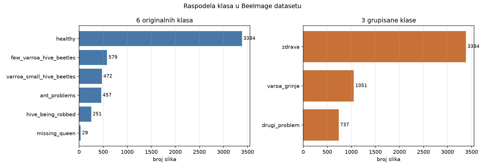
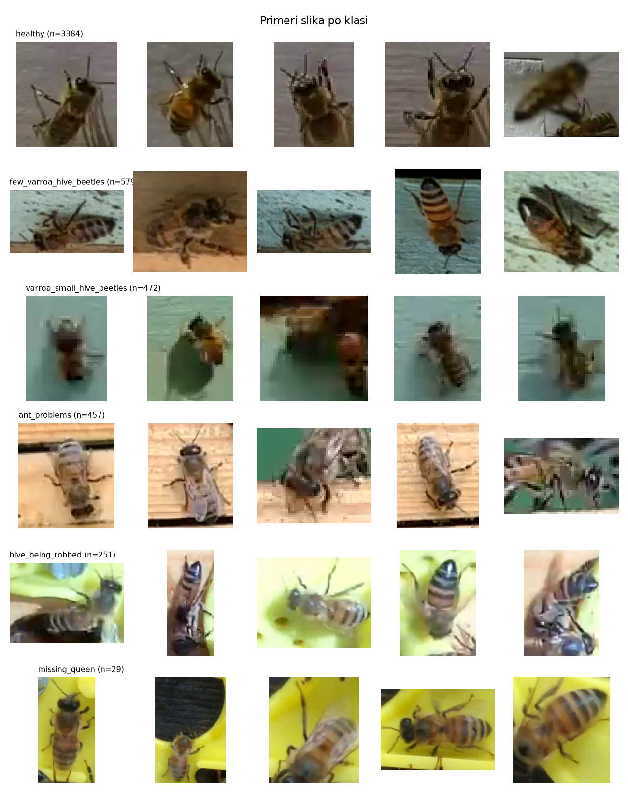

# Analiza BeeImage dataseta

- Ukupno slika sa oznakom i fajlom na disku: **5172**
- Razlicitih lokacija: **8**
- Razlicitih datuma snimanja: **16**

## Raspodela po 6 originalnih klasa

| originalna `health` vrednost | klasa (6) | broj slika | udeo |
|---|---|---|---|
| healthy | healthy | 3384 | 65.4% |
| few varrao, hive beetles | few_varroa_hive_beetles | 579 | 11.2% |
| varroa, small hive beetles | varroa_small_hive_beetles | 472 | 9.1% |
| ant problems | ant_problems | 457 | 8.8% |
| hive being robbed | hive_being_robbed | 251 | 4.9% |
| missing queen | missing_queen | 29 | 0.6% |

Najbrojnija klasa je healthy (3384 slika), najmanja missing_queen (29 slika) — odnos **117 : 1**.

## Raspodela po 3 grupisane klase

| klasa (3) | originalne klase koje ulaze | broj slika | udeo |
|---|---|---|---|
| zdrava | healthy | 3384 | 65.4% |
| varoa_grinje | few varrao, hive beetles, varroa, small hive beetles | 1051 | 20.3% |
| drugi_problem | ant problems, hive being robbed, missing queen | 737 | 14.2% |

## Dimenzije slika

| dimenzija | min | median | max |
|---|---|---|---|
| sirina | 27 | 61 | 346 |
| visina | 24 | 61 | 340 |

Slike su varijabilnih dimenzija (isecci pojedinacnih pcela), pa ih svaki
model skalira na svoju ulaznu rezoluciju preko zvanicnog `weights.transforms()`.

## Raspodela po lokaciji

| lokacija | broj slika | udeo |
|---|---|---|
| Saratoga, CA, USA | 2000 | 38.7% |
| Des Moines, IA, USA | 973 | 18.8% |
| Alvin, TX, USA | 737 | 14.2% |
| Athens, GA, USA | 579 | 11.2% |
| Athens, Georgia, USA | 472 | 9.1% |
| New Orleans, LA, USA | 170 | 3.3% |
| San Jose, CA, USA | 149 | 2.9% |
| Keene, NH, USA | 92 | 1.8% |

Mali broj lokacija je razlog zasto pored stratifikovane podele pravimo i
podelu disjunktnu po lokaciji — susedni isecci istog snimka inace zavrse
i u train i u test setu, pa je tacnost naduvana.

## Grafikoni

